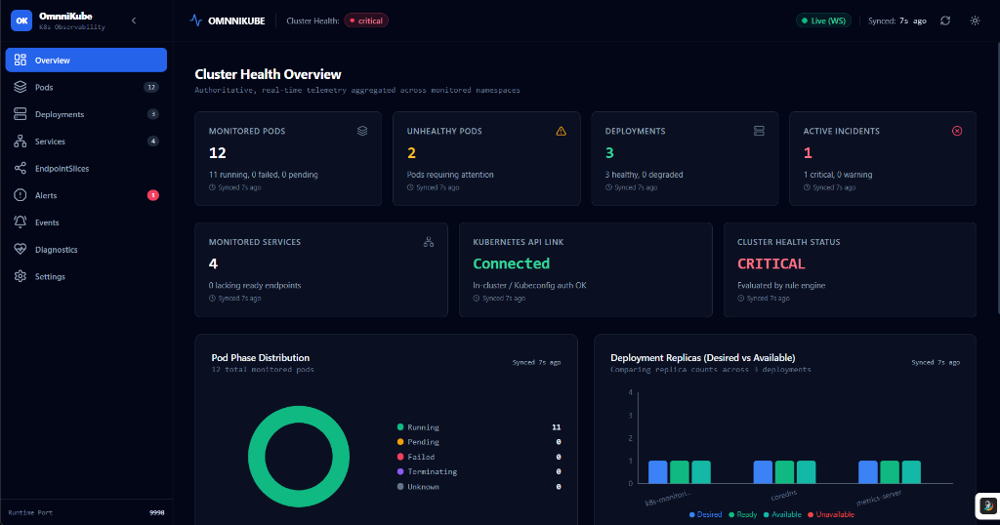
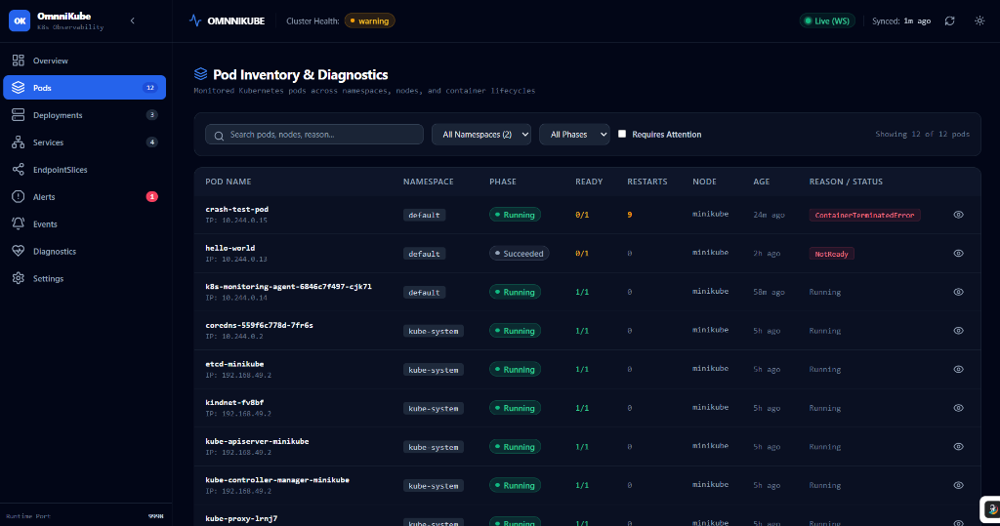

# ⚡ OmnniKube — Real-Time Kubernetes Observability Dashboard

<div align="center">


**A production-grade, low-latency, real-time observability frontend for Kubernetes clusters.**  
Built with React 18, Vite, TypeScript, TanStack Query v5, TanStack Table v8, and Recharts, connecting directly to the high-performance FastAPI Kubernetes Monitoring Agent.

[Architecture](#-functional-architecture) • [Snapshots](#-live-snapshots) • [No Fake Data Policy](#-strict-no-fake-data-policy) • [Quick Start](#-quick-start) • [Remote Setup](#-connecting-to-a-remote-server)

</div>

---

## 📸 Live Snapshots

Real cluster telemetry captured live from a running Kubernetes cluster:

### 1. Cluster Health Overview
Real-time cluster status, active incident counters, pod phase distribution donut chart, and deployment replica balance:


### 2. Pod Inventory & Lifecycle Diagnostics
Real-time container restart counts, pod phases, termination tracking, IP allocation, and error status badges:


---

## 🏛️ Functional Architecture

OmnniKube is engineered around a **Reactive Push-Pull Hybrid Architecture**:
1. **Push (Real-Time WebSocket Stream):** The client opens a persistent full-duplex WebSocket connection (`/api/ws`). On connection, an authoritative snapshot hydates the client cache. Incremental mutation events (`resource_updated`, `resource_deleted`, `alert_created`, `heartbeat`) trigger surgical cache updates.
2. **Pull (Resilient REST Polling Fallback):** If WebSocket connectivity drops, the client automatically falls back to periodic REST polling with exponential backoff and jitter, ensuring continuous cluster visibility.

```
┌─────────────────────────────────────────────────────────────────────────────┐
│                             KUBERNETES CLUSTER                              │
│                                                                             │
│   ┌──────────────┐      ┌──────────────┐      ┌─────────────────────────┐   │
│   │  Pods/Nodes  │      │ Deployments  │      │ Services/EndpointSlices │   │
│   └──────┬───────┘      └──────┬───────┘      └────────────┬────────────┘   │
└──────────┼─────────────────────┼───────────────────────────┼────────────────┘
           │                     │                           │
           ▼                     ▼                           ▼
┌─────────────────────────────────────────────────────────────────────────────┐
│                    PYTHON FASTAPI K8S MONITORING AGENT                      │
│                                                                             │
│   ┌─────────────────────────────────────────────────────────────────────┐   │
│   │              Async Informers & Thread-Safe Cache                    │   │
│   └──────────────────┬───────────────────────────────┬──────────────────┘   │
│                      │                               │                      │
│                      ▼                               ▼                      │
│             ┌─────────────────┐             ┌─────────────────┐             │
│             │ REST Endpoints  │             │   WebSocket     │             │
│             │  (/api/*)       │             │ Broadcaster     │             │
│             └────────┬────────┘             └────────┬────────┘             │
└──────────────────────┼───────────────────────────────┼──────────────────────┘
                       │                               │
                       │ REST Fallback                 │ Real-Time Push
                       │ (JSON via HTTP)               │ (/api/ws)
                       ▼                               ▼
┌─────────────────────────────────────────────────────────────────────────────┐
│                           OMNNIKUBE FRONTEND                                │
│                                                                             │
│  ┌───────────────────────────────────────────────────────────────────────┐  │
│  │                    WebSocket Client & Connection Engine               │  │
│  │   • Auto-Reconnect with Jitter   • Heartbeat Monitor (15s ping/pong)  │  │
│  └───────────────────┬───────────────────────────────────────────────────┘  │
│                      ▼                                                      │
│  ┌───────────────────────────────────────────────────────────────────────┐  │
│  │                     TanStack Query v5 Cache                           │  │
│  │   • Optimistic Mutations         • Stale-While-Revalidate             │  │
│  │   • Zod Runtime Schema Parsers   • Background Synchronization         │  │
│  └───────────────────┬───────────────────────────────────────────────────┘  │
│                      ▼                                                      │
│  ┌───────────────────────────────────────────────────────────────────────┐  │
│  │                      Observability Presentation Layer                 │  │
│  │   • Overview Dashboard           • Pod Inventory & Diagnostics        │  │
│  │   • Deployment Replicas          • Services & EndpointSlices          │  │
│  │   • Active Incidents / Alerts    • Cluster Warning Events             │  │
│  │   • Agent Health & Diagnostics   • Dynamic Dark/Light Theme           │  │
│  └───────────────────────────────────────────────────────────────────────┘  │
└─────────────────────────────────────────────────────────────────────────────┘
```

### Component Data Flow
1. **FastAPI Watchers** capture informer events from the Kubernetes API server and update an in-memory thread-safe cache.
2. **Alert Engine** continuously evaluates alert rules (e.g. `CrashLoopBackOff`, `ImagePullBackOff`, `DegradedDeployment`, `StuckTerminating`) and dispatches lifecycle events.
3. **Broadcaster** delivers serialized event envelopes to connected OmnniKube sessions.
4. **Zod Validation Layer** (`src/api/schemas.ts`) parses every incoming payload at runtime to prevent schema drifts and runtime errors.
5. **TanStack Table & Recharts** render deterministic data visualizations without ever simulating or mocking missing cluster telemetry.

---

## 🛡️ Strict "No Fake Data" Policy

OmnniKube adheres to a zero-compromise data integrity principle:
- **Zero Mock Fallbacks:** When the cluster or agent is unreachable, the dashboard explicitly surfaces formatted error states (`[HTTP_ERROR]`, `[TIMEOUT]`, or `Disconnected`) with manual retry triggers.
- **No Synthetic Graphs:** If CPU/Memory utilization cannot be collected (e.g. `metrics-server` or Prometheus is not installed in the cluster), OmnniKube renders an informative `MetricsNotice` instead of fabricating flat lines or arbitrary percentages.
- **Deterministic Counts:** Pod phases, container restarts, and deployment replica differences reflect exact cluster states.

---

## 🚀 Key Observability Features

| Feature View | Description | Key Telemetry |
|---|---|---|
| **Overview** | High-level cluster health scorecard & distribution | Status pill, pod phase donut, replica comparison bar chart, active alert counts |
| **Pods** | Deep pod lifecycle inspection across namespaces | Phase tags, container restart aggregations, node assignments, age, IP allocation |
| **Deployments** | Deployment replica health & rollout tracking | Desired vs Ready vs Available vs Unavailable counts, condition messages |
| **Services** | Service routing & network discovery | Type (ClusterIP, NodePort, LoadBalancer), port mappings, selector inspection |
| **EndpointSlices** | Discovered pod IP endpoints backing services | Endpoint address list, ready vs unready endpoints, address family (IPv4/IPv6) |
| **Alerts** | Incident resolution center | Active vs Resolved status, severity levels (Critical, Warning, Info), auto-resolution |
| **Events** | Cluster-wide event stream | Warning vs Normal events, event repetition counts, target resource references |
| **Diagnostics** | Monitoring agent health & performance | Kubernetes API connectivity, cache freshness, watcher status, error diagnostics |
| **Settings** | UI preferences & custom agent endpoints | Dark / Light theme toggle, remote API URL configuration, polling adjustments |

---

## 🛠️ Quick Start

### Prerequisites
- **Node.js:** v18.0.0 or higher
- **npm:** v9.0.0 or higher (or pnpm / yarn)

### 1. Clone & Install Dependencies
```bash
git clone https://github.com/Bhavesh9480/OmniKube-Dashboard.git
cd OmniKube-Dashboard
npm install
```

### 2. Configure Environment (Optional)
By default, the Vite dev server proxies `/api` and `/api/ws` to `http://127.0.0.1:9999`. If your agent is running locally on port 9999, no changes are needed.

To configure explicit target endpoints, edit `.env`:
```env
# Optional: specify backend agent URL
VITE_API_BASE_URL=http://127.0.0.1:9999
VITE_POLLING_INTERVAL_MS=10000
```

### 3. Run Development Server
```bash
npm run dev
```
Open **[http://127.0.0.1:9998](http://127.0.0.1:9998)** in your browser.

### 4. Build for Production
```bash
npm run build
npm run preview
```

### 5. Run Test Suite
```bash
npm test
```

---

## 🌐 Connecting to a Remote Server

To connect OmnniKube to a FastAPI agent running on an external server or cloud VM:

### Method A: Via the Dashboard UI (Instant — No Restart Needed)
1. Navigate to **Settings** in the left sidebar.
2. Under **Backend API Base URL**, enter your public server address:
   ```
   http://YOUR_SERVER_IP:9999
   # or https://k8s.yourdomain.com if using SSL
   ```
3. Click **Save Settings**. Both REST and WebSocket endpoints will dynamically re-route immediately.

### Method B: Via Environment File
Edit `.env` before running or building:
```env
VITE_API_BASE_URL=http://YOUR_SERVER_IP:9999
```

---

## 🧪 Testing & Code Quality

The frontend includes unit and integration tests powered by Vitest and React Testing Library:
- **API Client & Error Handling:** Validates timeout enforcement, schema error normalization, and retry behavior.
- **Data Integrity Tests:** Ensures `MetricsCard` marks stale data honestly, `EmptyState` displays zero-count states without fake placeholders, and `PodStatusDonut` never renders artificial sectors.

---

## 📄 License

This project is licensed under the MIT License - see the [LICENSE](LICENSE) file for details.
